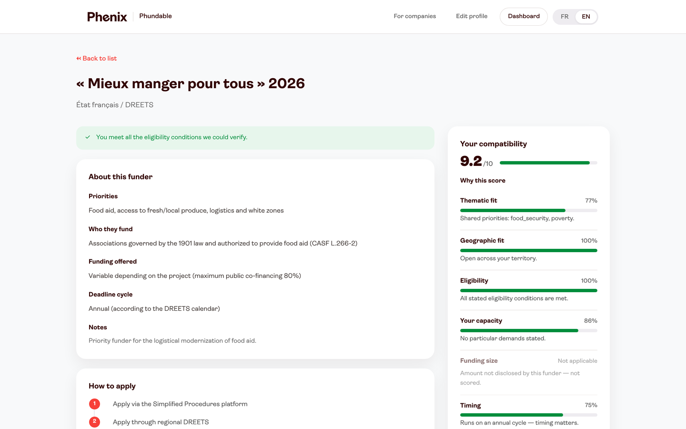

# Hi, I'm Federico 👋

I design and build products that start from a real user problem. I'm studying for the **Master in Marketing, Product & Tech track at HEC Paris**. Before that, I spent six months at the Startup Geeks incubator taking **15 early-stage startups through product discovery**: interviewing users, running landing-page smoke tests, scoping MVPs and deciding GO / NO-GO before anything was built.

I sketch flows, prototype fast and ship working products, mostly to test whether an idea holds up with real users.

📍 Paris · 🔗 [LinkedIn](https://www.linkedin.com/in/federico-balucani) · ✉️ federico.balucani@gmail.com

---

## Selected work

| | |
|---|---|
|  | **[APEX](https://github.com/federico113233/APEX): an AI career copilot that augments students instead of replacing them** Research with 139 students and 12 interviews turned into one design rule: *augment the candidate's voice, never replace it*. I designed and built the app end to end: CV tailoring that asks before it writes, a live voice mock-interview studio and a mobile-first job tracker. `research` `product design` `UX/UI` `AI` · [apexapply.app](https://apexapply.app) |
|  | **[Phundable](https://github.com/federico113233/phundable): grant matching that shows its reasoning** Built in 4 days at the HEC Paris AI-ckathon, on a brief from Phenix. I led UX and built the prototype: one onboarding, five scored funding families, and every score explained line by line. `hackathon` `UX` `prototype` `trust & transparency` |
|  | **[Odyssey Studio](https://github.com/federico113233/Odyssey-Studio): learn a strategy tool by predicting, then comparing** A practice tool for HEC's value-curve course: predict the curve, compare it with the course's reading, then argue with an AI coach that has to justify itself. `learning design` `interaction design` · [live](https://odyssey-studio-seven.vercel.app) |

---

**How I work:** I start from users, write down the rule the product must never break, ship the smallest version that tests it, then cut what real use proves unnecessary.
